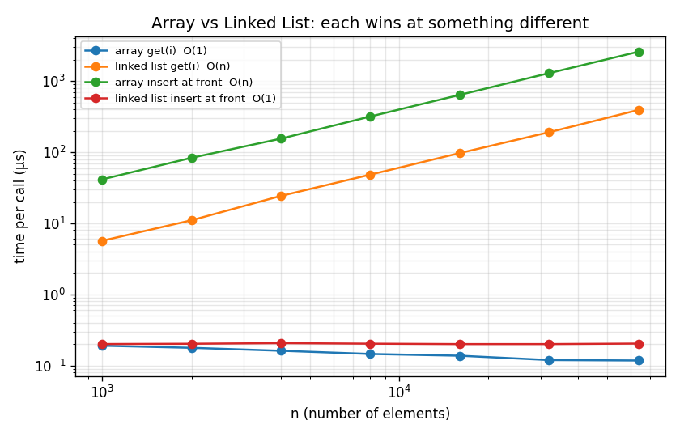

# Arrays, Linked Lists, Stacks & Big-O Analysis
 
Hand-written implementations of three core data structures, unit tests for
correctness, and a benchmark that **measures** each operation and checks that
the observed growth matches the predicted Big-O.
 
**Result: 54 / 54 tests pass, and 16 / 16 operations match their predicted complexity.**
 
Measured on a MacBook (macOS), Python 3.9.6.
 
## Project layout
 
```
big_o_project/
├── dynamic_array.py      resizable array (doubles capacity when full)
├── linked_list.py        singly linked list with head + tail pointers
├── stack.py              ArrayStack and LinkedListStack
├── benchmark.py          times every operation, fits Big-O, draws graphs
├── conftest.py           lets pytest import the modules
├── tests/                54 pytest test cases
└── results/              results.md + graphs (generated by benchmark.py)
```
 
## How to run
 
```bash
python3 -m venv .venv
source .venv/bin/activate
pip install --upgrade pip
pip install pytest matplotlib
 
python -m pytest -v        # correctness: 54 tests
python benchmark.py        # performance: prints table, writes results/
```
 
## Predicted complexity
 
| Structure | Operation | Big-O | Why |
|---|---|---|---|
| DynamicArray | `get(i)`, `set(i)` | O(1) | direct jump to `start + i × size` |
| DynamicArray | `append` | O(1) amortized | usually 1 write; a resize copies n items but happens only after n appends |
| DynamicArray | `pop` | O(1) | remove from end, nothing shifts |
| DynamicArray | `insert(i)`, `delete(i)` | O(n) | everything after `i` shifts |
| DynamicArray | `search(x)` | O(n) | may check every element |
| LinkedList | `push_front`, `pop_front` | O(1) | just move the head pointer |
| LinkedList | `push_back` | O(1) | thanks to the tail pointer |
| LinkedList | `pop_back` | O(n) | must walk to the node *before* the tail |
| LinkedList | `get(i)`, `insert(i)`, `search(x)` | O(n) | no jumping, must walk node by node |
| ArrayStack | `push`, `pop`, `peek` | O(1)* | top = end of array (*push amortized) |
| LinkedListStack | `push`, `pop`, `peek` | O(1) | top = head of list |
 
## How Big-O is verified
 
If `time = c · nᵏ`, then `log(time) = k · log(n) + log(c)`, so on a log-log
plot the points form a straight line with **slope k**. The benchmark times each
operation at n = 1k, 2k, 4k … 64k, fits that slope with least squares, and classifies it:
 
- slope ≈ 0 → **O(1)** (time stays flat as n doubles)
- slope ≈ 1 → **O(n)** (time doubles as n doubles)
Each measurement is the best of 5 runs, and fast O(1) operations are repeated
2,000 times so the timer can actually see them.
 
## Observed results
 
Time per call in microseconds (µs).
 
| Structure | Operation | Expected | Observed | Slope | n=1k | n=2k | n=4k | n=8k | n=16k | n=32k | n=64k | Match |
|---|---|---|---|---|---|---|---|---|---|---|---|---|
| DynamicArray | `get(middle)` | O(1) | O(1) | -0.12 | 0.19 | 0.18 | 0.16 | 0.15 | 0.14 | 0.12 | 0.12 | ✅ |
| DynamicArray | `append` | O(1) | O(1) | -0.02 | 0.16 | 0.16 | 0.16 | 0.15 | 0.15 | 0.15 | 0.15 | ✅ |
| DynamicArray | `pop` | O(1) | O(1) | -0.01 | 0.15 | 0.15 | 0.15 | 0.15 | 0.15 | 0.15 | 0.15 | ✅ |
| DynamicArray | `insert(0)` | O(n) | O(n) | 0.99 | 41.45 | 83.44 | 155.05 | 317.43 | 639.15 | 1293.20 | 2585.83 | ✅ |
| DynamicArray | `delete(0)` | O(n) | O(n) | 1.02 | 37.88 | 78.32 | 157.47 | 316.67 | 645.15 | 1268.60 | 2641.55 | ✅ |
| DynamicArray | `search(miss)` | O(n) | O(n) | 1.01 | 21.99 | 44.67 | 89.90 | 184.70 | 370.61 | 736.90 | 1494.98 | ✅ |
| LinkedList | `push_front` | O(1) | O(1) | -0.00 | 0.20 | 0.20 | 0.21 | 0.20 | 0.20 | 0.20 | 0.20 | ✅ |
| LinkedList | `push_back` | O(1) | O(1) | 0.00 | 0.20 | 0.20 | 0.21 | 0.21 | 0.21 | 0.21 | 0.21 | ✅ |
| LinkedList | `pop_front` | O(1) | O(1) | 0.00 | 0.15 | 0.15 | 0.15 | 0.15 | 0.15 | 0.15 | 0.15 | ✅ |
| LinkedList | `pop_back` | O(n) | O(n) | 1.00 | 23.11 | 44.72 | 95.69 | 189.68 | 354.10 | 731.03 | 1462.89 | ✅ |
| LinkedList | `get(middle)` | O(n) | O(n) | 1.02 | 5.68 | 11.05 | 24.31 | 48.39 | 97.25 | 190.89 | 392.70 | ✅ |
| LinkedList | `search(miss)` | O(n) | O(n) | 1.01 | 38.12 | 81.73 | 160.20 | 320.71 | 642.21 | 1313.96 | 2608.90 | ✅ |
| ArrayStack | `push` | O(1) | O(1) | 0.01 | 0.19 | 0.20 | 0.19 | 0.20 | 0.20 | 0.20 | 0.20 | ✅ |
| ArrayStack | `pop` | O(1) | O(1) | -0.00 | 0.29 | 0.28 | 0.28 | 0.28 | 0.28 | 0.28 | 0.28 | ✅ |
| LinkedListStack | `push` | O(1) | O(1) | -0.00 | 0.24 | 0.25 | 0.23 | 0.24 | 0.24 | 0.24 | 0.24 | ✅ |
| LinkedListStack | `pop` | O(1) | O(1) | -0.00 | 0.28 | 0.28 | 0.28 | 0.28 | 0.28 | 0.28 | 0.28 | ✅ |
 
Timings depend on the machine; the **slopes** are what should match on any machine.
 
**In short:** when n grew 64× (1k → 64k), every O(n) operation got about
62–70× slower (e.g. `insert(0)`: 41 µs → 2,586 µs), while every O(1)
operation stayed between 0.12 and 0.29 µs regardless of size.
 
### Amortized append (DynamicArray)
 
| n appends | avg ns per append | resizes |
|---|---|---|
| 1,000 | 163 | 8 |
| 2,000 | 143 | 9 |
| 4,000 | 137 | 10 |
| 8,000 | 137 | 11 |
| 16,000 | 141 | 12 |
| 32,000 | 148 | 13 |
| 64,000 | 143 | 14 |
 

 
## Observations
 
1. **Array vs linked list is a trade-off, not a winner.** The array is O(1) at
   `get(i)` (0.12–0.19 µs) but O(n) at inserting at the front (41 → 2,586 µs).
   The linked list is the exact opposite: `push_front` stays at 0.20 µs while
   `get(middle)` grows from 5.7 to 393 µs (see graph above).
2. **Amortized ≠ every call is fast.** The array resized 8 → 14 times as n grew
   from 1k to 64k, and each resize copies every element (O(n)). Yet the average
   cost per append stayed flat at ~140–160 ns, because doubling the capacity
   makes resizes rarer as the array grows. During development, measuring only
   2,000 appends on top of an existing array gave a misleading slope of ~0.5,
   because one big resize landed inside that small window. Amortized cost must be
   averaged over the whole sequence of appends from empty.
3. **Same Big-O, different constants.** `LinkedList.search` was about 1.7–1.8×
   slower than `DynamicArray.search` at every size (e.g. 2,609 µs vs 1,495 µs at
   64k), even though both are O(n). Following node pointers costs more per step
   than walking a contiguous block. Big-O describes how time grows, not raw speed.
4. **Where you put the stack's top matters.** Both stacks are O(1) because the
   top sits at the cheap end (array end / list head). Putting it at the other
   end would make `pop` O(n).
## Test cases (54, all passing)
 
- **DynamicArray:** empty state, append/get, set, growth past capacity with exact
  resize count, insert at front/middle/end, delete shifting, pop, search hit/miss,
  out-of-range and empty errors.
- **LinkedList:** push front/back ordering, pop front/back down to empty (head and
  tail reset), get, insert at all positions, delete head/middle/tail with tail
  pointer kept correct, search, error cases.
- **Stacks** (every test runs on both implementations): LIFO order, peek doesn't
  remove, 1,000 items, empty errors, and a **bracket-matching checker** as a
  real-world use case (`{[()]}` valid, `{[(])}` invalid, etc.).
## Connection to AI work
 
Python's `list` is a dynamic array, and NumPy arrays / PyTorch tensors are
contiguous blocks, which is why indexing them is O(1) and why inserting at the
front of a big array is something to avoid. Stacks underpin depth-first search
and the call stack behind recursion.
 
